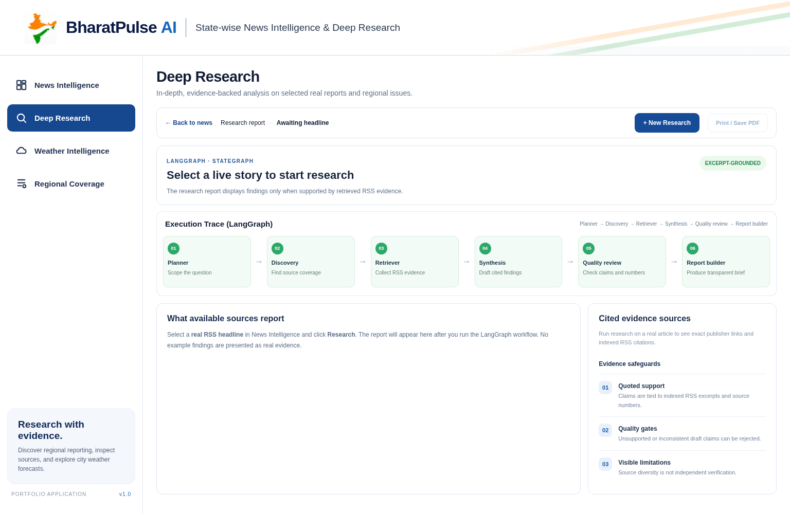
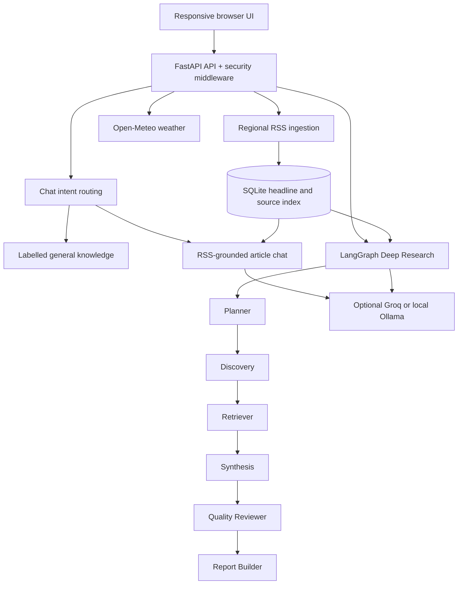

<div align="center">

# BharatPulse AI

### Understand the story behind India's headlines.

**State-wise News Intelligence &nbsp;·&nbsp; Six-Stage Deep Research &nbsp;·&nbsp; Weather Intelligence**

[](https://github.com/Sid-art6/BharatPulse-AI-State-Wise-News-Intelligence-Deep-Research-Platform./actions)    

**A local-first, source-grounded AI engineering portfolio application for investigating regional news and city weather across India.**

[Explore the architecture](#architecture) · [Run locally](#run-locally) · [Deploy on Render](#public-demo-deployment) · [Security model](#security-and-trust)

**Live public demo:** *A URL will be added only after a successful Render deployment and smoke test.*

</div>

---

## Product preview

> These are browser captures of the implemented **HTML/CSS/JavaScript frontend**, rendered against controlled offline test fixtures. **They are not captures of live news, live meteorology or a completed AI research run.** News cards are explicitly labelled as illustrative; weather values are from an offline UI test fixture. The images demonstrate the three-screen layout, not the availability or factual correctness of live feeds. Replace them with verified live-service captures after deployment.

### News Intelligence


*Browse state-wise RSS entries, topic filters, original publisher references and transparent coverage signals. This screenshot uses illustrative demo headlines.*

<table>
<tr><td width="50%"><strong>Six-Stage Deep Research</strong><br/><br/><small>Workflow interface; no fabricated completed report.</small></td><td width="50%"><strong>Weather Intelligence</strong><br/><br/><small>Forecast rendering checked with explicit offline test data.</small></td></tr>
</table>

## Running the reliability release

**v1.6 objective-grounded QA update (25 November 2026):** The Deep Research Planner now identifies incident-specific objectives (event dates, official statements, casualties, assistance, attribution, location and subsequent developments), and Report Builder reconciles them against source passages and approved findings instead of declaring supported facts unknown. The quantity inventory also recognises forms such as “11 injured” and “two visitors”. In Ask AI, a model response that fails review can fall back to a narrowly selected, verbatim publisher passage rather than an irrelevant headline-only refusal. These are platform-wide rules, not hardcoded answers for individual articles. See [v1.6 QA and deployment gate](docs/V16_QA_AND_DEPLOYMENT.md).

**Verification scope:** The offline suite was completed in isolated groups: 239 passed, 7 skipped, zero failed. The seven skipped cases require LangGraph in this testing environment. Live Groq answer generation and permitted publisher access must still be checked on the deployment machine.


Start with the [Windows setup](START_HERE.md). The [repair and verification report](docs/REPAIR_AND_VERIFICATION.md) records the root causes, live publisher checks, test scope and operating limits. Ask AI loads evidence in the background and shares the selected article context with Deep Research. Publisher-syndicated text and direct page text carry separate provenance.

## Context-first chat and short-term memory

The current implementation corrects a recurring acronym-context failure: a question such as **“What is SIR?”** in an elections article now uses the selected article's RSS title, excerpt and topic **before** choosing a meaning. Unknown abbreviations are handled by a context-aware single general-model prompt, not by a long list of story-specific hardcoded answers. Documented legal arguments can be quoted without falsely presenting them as court rulings.

Conversation memory is **first-party, small and isolated**: the most recent five question/answer pairs per selected article are stored in SQLite for up to 24 hours, keyed to a secure random browser-session cookie. Only previous **user questions**, not AI answers, are fed back to resolve references; users can reopen or clear a conversation. There is **no paid memory service, vector database or embedding API**.

An **optional**, disabled-by-default Google News RSS lookup can fetch related headlines for explicit fresh-news queries (`BHARATPULSE_ENABLE_ON_DEMAND_RSS_SEARCH=true`). It is free of paid search API fees, but it does **not** read full publisher articles, prove factual correctness or provide a reliable live-web search SLA.

The application remains RSS-grounded: article claims can require multiple Groq calls for a safety review; automated tests are not a substitute for live model evaluation. See [context-first memory and QA notes](docs/CONTEXT_FIRST_MEMORY_QA.md).

## What it does

| Capability | Engineering implementation |
|---|---|
| **India-wide regional discovery** | RSS feeds for 28 states, 8 union territories and national news; selected regional-language searches and curated direct publisher feeds |
| **Traceable source data** | Source URLs, publisher/feed-origin labels, region-confidence rules, deduplication and SQLite metadata storage |
| **Context-first, memory-enabled AI chat** | Article metadata informs acronym disambiguation; session-isolated SQLite memory supports follow-ups; general background stays distinct from cited RSS claims |
| **RSS evidence safeguards** | Claim decomposition, exact excerpt quotation, numeric validation, conservative semantic review and explicit abstention when evidence is missing |
| **Six-stage LangGraph research** | Planner → Discovery → Retriever → Synthesis → Quality Reviewer → Report Builder, including a visible execution trace |
| **Research quality signals** | Source-by-source title/excerpt comparison, headline-only vs excerpt coverage, possible overlap and numerical mentions, **without presenting these as fact checks** |
| **Multilingual support** | Native-script feed discovery and an optional 13-language response interface, with verified translation fallback behaviour |
| **Weather intelligence** | Open-Meteo current conditions and seven-day city forecasts; Leaflet map of **city-point** temperatures, not a national heatmap |
| **Public demo controls (v1.1)** | Opt-in AI access, per-client and global provider-call limits, read/write quotas, host restrictions, security headers and streamed request-size constraints |
| **Automated tests and CI** | Offline API, evidence workflow, regional coverage, weather and public-demo security regression checks |

## Reliability and research improvements (v1.3)

Version 1.3 follows a **source-first, question-aware** architecture, not a collection of hardcoded answers for particular news items.

- **Ask AI identity guard:** compound questions about a person named in the selected article no longer enter free-form biographical generation. It is never valid to invent previous employers, ownership, motives or appointment dates from an RSS headline.
- **Direct metadata answers:** publisher, feed timestamp (not the event date), feed origin and source link are returned from indexed fields; no LLM call is needed.
- **Question relevance:** a correctly quoted announcement does not answer a question about a predecessor, previous role, exact date, responsibilities or implications unless the quote actually contains that information.
- **Six-node research handoff:** Planner extracts requested information categories and constructs one bounded supplementary RSS query when relevant. Discovery keeps search results request-scoped; Retriever ranks potentially same-incident reporting. Synthesis generates claims from exact evidence. Quality Reviewer approves or rejects them. Report Builder assembles an attributed summary, source highlights and explicit gaps.
- **Two evidence classes, visibly separated:** AI-reviewed findings and additional literal RSS reporting are never silently combined or portrayed as independently verified. Different publishers may rely on the same original report.
- **More informative reports:** a second potentially relevant headline is visible in a prominent section even if the model generates only one approved finding. Requested research topics show whether available RSS text explicitly mentions the requested information.
- **QA:** additional synthetic, topic-independent tests plus `python scripts/verify_local.py` for a smoke test of a running app. Offline tests do not prove that Groq responses will always be accurate.

**Historical v1.3 research depth limit:** Most indexed entries included only a headline. The new v1.4 optional, permitted article reader may provide additional text, but it never bypasses paywalls or claims to read inaccessible pages. It therefore cannot establish a subject's complete biography or the exact date of an event absent from the RSS metadata. The useful outcome for such questions is a clearly identified evidence gap, not a fabricated answer.

For the release test procedure, see [Final Release Verification](docs/FINAL_RELEASE_VERIFICATION_V1_3.md).

## Reliability improvements (v1.2 — Claude audit cross-check)

This version integrates high-priority findings from a separate 24 November 2026 code audit: safer event-slot routing, deterministic RSS publisher/date/link answers, a shared evidence-normalisation module, recognition of headline-only pseudo-excerpts, per-claim reviewer decisions, bounded historical evidence retrieval, stricter general-answer leakage controls, and research-only RSS discovery that **does not modify the live news feed**. It also improves forecast-query parsing and frontend request identity handling.

**Operational boundary:** The six LangGraph stages are a coordinated workflow, not six independent LLM agents. Synthesis and review invoke the model; the other stages provide planning, discovery, retrieval and report assembly. If the model is unavailable, stages explicitly report skipped status instead of inventing findings.

See [Claude audit integration and remaining limitations](docs/CLAUDE_AUDIT_INTEGRATION.md).

## Reliability improvements (v1.1)

This release is **platform-wide**, not tailored to any named event. It keeps named article subjects and article-specific identity questions on the quoted-RSS evidence path. Publisher-identification questions return the selected source directly; related-topic headlines are separated from possible same-story coverage and do not qualify as proof of the selected incident. Generated assertions still require exact quotation, numerical support and a separate semantic review. All six LangGraph stages are visible, including skipped/degraded stages, and numeric coverage shows reported units beyond currency.

The application cannot guarantee that a model never hallucinates or that a publisher's source excerpt is true; independent verification and full-text coverage remain outside scope. See [release verification](docs/RELEASE_VERIFICATION_V1_1.md) and [technical reliability design](docs/PLATFORM_RELIABILITY_V1_1.md).

## Try the main workflows

1. **Discover regional coverage:** choose a state, enter multiple keywords, select a category, and reset filters without losing the underlying RSS index.
2. **Ask a background question:** “What is a passport?” or “What is an FIR?” — labelled general AI explanation, **not** an article citation.
3. **Ask about reporting:** “What evidence supports this claim?” — the app quotes indexed RSS metadata and distinguishes a publisher's statement from independent confirmation.
4. **Ask a mixed question:** “What is Bali Jatra, and what does the article say?” — two clearly identified sections: general background and available article reporting.
5. **Run Deep Research:** inspect the LangGraph execution trace, reviewed findings, publisher-by-publisher RSS title/excerpt comparisons, and explicit evidence limitations.

> **Source scope:** RSS metadata is always available for indexed sources; accessible publisher text is optional and explicitly labelled. It cannot provide a full-article summary when retrieval was blocked or incomplete. For journalism and consequential decisions, read the original publisher reports.

## Architecture



Six nodes represent distinct processing stages, not six independent LLMs. Synthesis and review may call Groq/Ollama; the other stages are deterministic. Missing AI configuration appears as explicitly skipped steps rather than silent bypass.

**Engineering choices.** News questions remain evidence-constrained; general-knowledge questions use a separate explanation path, with any relevant selected RSS headline explicitly labelled and cited. Mixed questions label general background and article evidence independently. Original RSS metadata is retained and quoted rather than treating a language-model response as ground truth. Research stages have explicit inputs and quality checks, and the application can abstain when evidence is inadequate. The Open-Meteo forecast is kept separate from RSS weather headlines.

## Technology stack

| Layer | Technologies |
|---|---|
| Backend | Python, FastAPI, Pydantic, HTTPX, Uvicorn |
| Agent orchestration | LangGraph StateGraph; structured, multi-stage execution trace |
| AI | Groq API; optional Ollama for local execution |
| Data | SQLite, RSS/XML processing, source provenance and keyword-based retrieval |
| Weather and maps | Open-Meteo, Leaflet, OpenStreetMap tiles |
| Frontend | JavaScript, semantic HTML, responsive CSS |
| Quality and delivery | Pytest, GitHub Actions, Render Blueprint, basic public-demo security controls |

## Run locally

**Requirements:** Python 3.12 recommended; Python 3.11 is also supported by the project requirements.

```powershell
# Windows PowerShell, from the project folder
py -3.12 -m venv .venv
.\.venv\Scripts\Activate.ps1
python -m pip install -r requirements-dev.txt
Copy-Item .env.example .env
# Edit .env only on your machine. Set GROQ_API_KEY if you want Groq features.
python -m pytest -q
python -m uvicorn app.main:app --host 127.0.0.1 --port 8000 --reload
```

Open **http://127.0.0.1:8000**. Demo mode shows invented, prominently labelled training scenarios. Live mode fetches RSS entries and requires source availability. LangGraph and public AI need their respective dependencies and provider settings; never paste a private key in a GitHub issue or README.

## Public demo deployment

This repository contains [`render.yaml`](render.yaml), a free-tier **Render Blueprint** for the FastAPI server. See [deployment instructions](docs/DEPLOY_RENDER_V10.md) for connecting the repository, creating the service, checking `/api/health`, configuring secrets, and enabling guarded public AI only when appropriate.

**Important operational boundaries:** Render free services can sleep when idle; SQLite is placed in `/tmp` and is **ephemeral** on restart/redeploy; background RSS polling is not an always-on job on this tier. The application refreshes its index when visited. This is a portfolio demonstration, not a 24/7 news or meteorological warning service.

## Security and trust

- **No committed secrets.** `.env` and local databases stay out of source control. Set keys in deployment environment variables only.
- **AI off by default on the public server.** `BHARATPULSE_PUBLIC_AI_ENABLED=false` protects the Groq budget until an operator explicitly enables controlled usage.
- **Bounded public traffic.** Single-process quotas allow at most 6 AI requests per client and 30 AI requests globally per hour (while running), with separate RSS and read limits. Streamed request bodies are capped at 16 KiB, and cross-origin browser writes are restricted. These limits reset on restart and are not a spending guarantee.
- **Browser protections.** Restrictive host validation (when configured), Content Security Policy, anti-framing, MIME-sniffing and referrer controls.
- **Truthfulness.** Only publisher RSS titles/excerpts are indexed. Source diversity, numerical mentions, model judgements and publisher labels are **not independent factual verification**.
- **Security caveat.** In-memory quotas are not distributed across instances and can be evaded by distributed clients. A high-traffic paid production service needs WAF/edge limiting, stronger authentication, persistent storage, audit logging and a full external security review.

Full details: [Public demo safety](docs/SECURITY_V10.md) and [second-pass fixes and remaining limitations](docs/V1_SECOND_PASS_RELEASE_NOTES.md).

## Tests and engineering validation

**Context-first candidate QA:** 135 local tests passed; 6 LangGraph-dependent tests skipped in the packaging environment. Live Groq requests and a full browser-session check require your own configured local environment before the final GitHub release. See [final context QA and Windows acceptance checklist](docs/FINAL_V1_CONTEXT_VALIDATION.md).

```bash
python -m compileall -q app
python -m pytest -q
```

The automated suite covers RSS parsing and deduplication, evidence and numeric checks, weather normalisation, LangGraph integration, API contracts, v1.0 public safety middleware, and dedicated regression cases for complaint-definition typos, unsupported named roles, article causality, mixed questions and multi-source citation deduplication. The frontend design follows three supplied reference photos, while a visible AI status control supports local connection testing; see [design fidelity and accuracy boundaries](docs/PHOTO_MATCH_V10.md). GitHub Actions executes it on Ubuntu with Python 3.12.

## Project constraints

BharatPulse AI is an **engineering portfolio project**, not an official news agency, independent fact-checking organisation, or meteorological authority. News may be incomplete or stale; RSS providers can restrict or change their feeds; AI outputs may contain errors. Always inspect original publishers and authoritative weather warnings for consequential decisions.

---

<div align="center">
<strong>Built to demonstrate practical AI engineering—not just prompting.</strong><br/>
<sub>FastAPI · LangGraph · source-grounded RAG · multilingual workflows · weather APIs · reproducible tests</sub>
</div>
