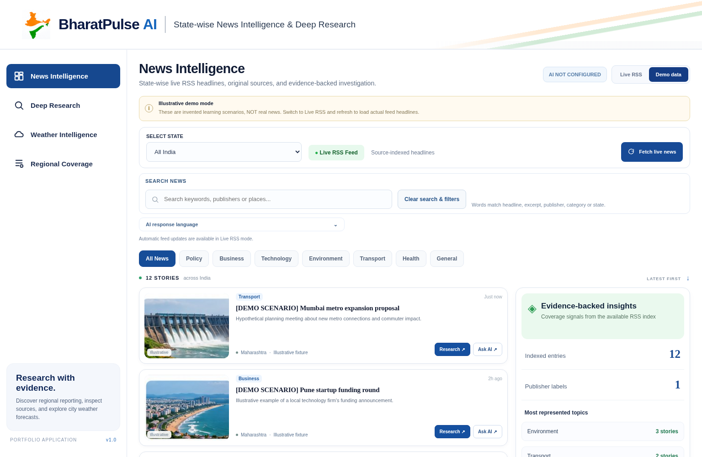
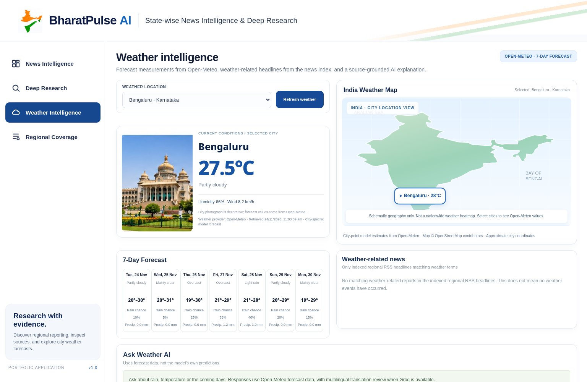
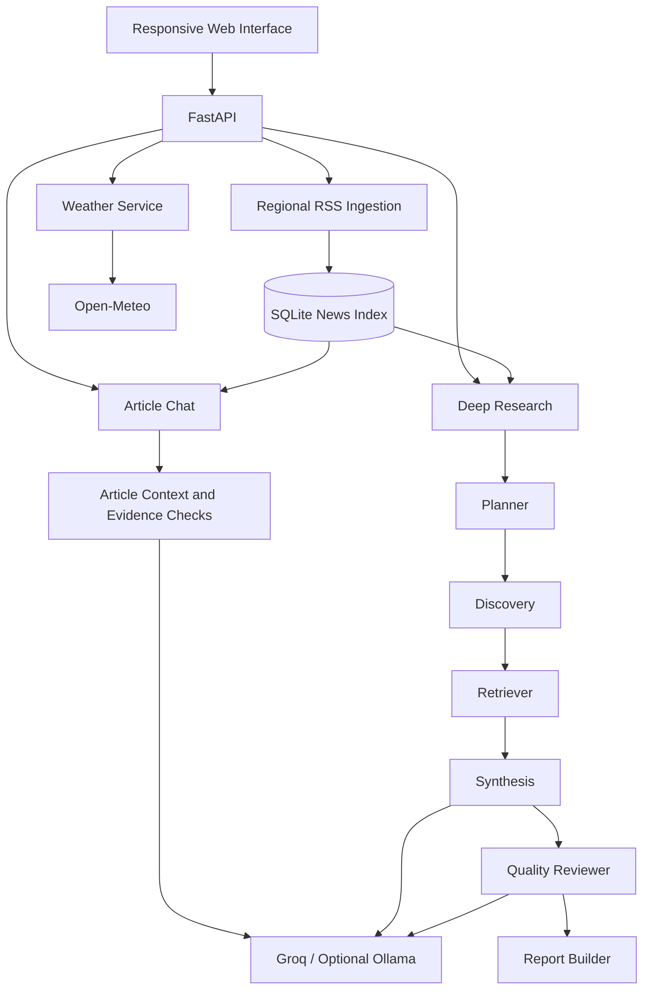

<div align="center">

# BharatPulse AI

### Understand the story behind India's headlines.

**State-wise News Intelligence · Evidence-Grounded Article Chat · LangGraph Deep Research · Weather Intelligence**

[](https://github.com/Sid-art6/BharatPulse-AI-State-Wise-News-Intelligence-Deep-Research-Platform./actions)


**An AI-powered news intelligence platform for exploring Indian regional reporting, researching individual stories, and viewing city-level weather.**

**Live Demo:** [Explore BharatPulse AI](https://bharatpulse-ai.onrender.com/)

[Features](#features) · [Architecture](#architecture) · [Run locally](#getting-started) · [Deployment](#deployment) · [Security](#security-and-limitations)

</div>

---

## Overview

India's news landscape spans many states, languages, publishers, and local issues. BharatPulse AI brings regional news discovery, article-focused questions, structured research, and weather information into one responsive interface.

The core design principle is **source transparency**: distinguish what a publisher reports from what can be independently established. AI-generated findings are checked against available source excerpts and, when access is permitted, retrieved publisher passages. Missing evidence should be identified rather than filled with invented details.

## Product preview

### Regional news explorer



Browse stories by state or union territory, topic, and search terms, with publisher links and source attribution.

<table>
<tr>
<td width="50%">
<strong>Deep Research</strong><br/>
<br/>
<small>Structured, source-aware research workflow.</small>
</td>
<td width="50%">
<strong>Weather Intelligence</strong><br/>
<br/>
<small>City forecasts and map-based weather exploration.</small>
</td>
</tr>
</table>

> **Screenshot note:** These screenshots were captured using controlled demonstration fixtures. They illustrate the interface, not independently verified live reporting, weather readings, or completed live AI research.

## Features

| Feature | What it does |
|---|---|
| **Regional news discovery** | Aggregates RSS news coverage across Indian states, union territories, and national topics, including selected regional-language and direct publisher feeds. |
| **Source-aware news index** | Tracks headlines, publisher labels, feed provenance, publication metadata, and related reporting in SQLite. |
| **Article Chat — Ask AI** | Answers questions about a selected article using source metadata, accessible publisher passages, and clearly separated general background. |
| **Article context preparation** | Attempts permitted article retrieval in the background and reuses available evidence for follow-up questions. |
| **Deep Research** | Uses a six-stage LangGraph workflow to plan, discover, retrieve, synthesise, review, and assemble a cited report. |
| **Evidence safeguards** | Checks quotation support, numerical claims, incident relevance, and unsupported assertions; surfaces limitations when evidence is insufficient. |
| **Multilingual interface** | Supports regional discovery and selectable response languages, subject to provider and source availability. |
| **Weather intelligence** | Shows city conditions, multi-day forecasts, and an interactive map using Open-Meteo and Leaflet. |
| **Automated testing** | Includes API, ingestion, evidence, research, weather, and security regression tests, with GitHub Actions CI. |

## How the AI workflow works

1. **Discover:** RSS sources provide headlines, timestamps, and publisher references.
2. **Prepare context:** The app attempts to locate publicly accessible publisher content when retrieval is permitted. Otherwise, it retains a clearly labelled headline/excerpt-only evidence boundary.
3. **Answer:** Ask AI distinguishes article-specific questions, metadata, general explanations, and follow-ups.
4. **Research:** LangGraph coordinates six stages for question-aware discovery, source retrieval, evidence-based synthesis, claim review, and report generation.
5. **Show provenance:** Responses cite available sources and indicate uncertainty or gaps where appropriate.

The workflow **does not guarantee independent fact-checking**. Multiple publisher headlines can repeat the same underlying report, and inaccessible article text cannot be assumed.

## Architecture



The six LangGraph nodes are **distinct workflow stages**, not six independent language models. AI calls are concentrated in the generation and review steps; other stages handle retrieval, orchestration, and report assembly.

### Technology stack

| Layer | Technologies |
|---|---|
| Backend | Python, FastAPI, Pydantic, HTTPX, Uvicorn |
| AI & orchestration | Groq, LangGraph; optional local Ollama |
| Storage & retrieval | SQLite, RSS/XML, publisher provenance, article-context caching |
| Frontend | HTML, CSS, JavaScript |
| Weather & maps | Open-Meteo, Leaflet, OpenStreetMap |
| Testing & delivery | Pytest, GitHub Actions, Render Blueprint |

## Getting started

**Requirements:** Python 3.11 or later, Git, and an internet connection for live feeds. A Groq API key is optional for browsing news but required for Groq-powered AI features.

### 1. Clone the repository

```powershell
git clone https://github.com/Sid-art6/BharatPulse-AI-State-Wise-News-Intelligence-Deep-Research-Platform..git
cd BharatPulse-AI-State-Wise-News-Intelligence-Deep-Research-Platform.
```

### 2. Install dependencies

```powershell
py -3.11 -m venv .venv
.\.venv\Scripts\python.exe -m pip install -r requirements-dev.txt
```

### 3. Configure environment

```powershell
Copy-Item .env.example .env
notepad .env
```

For Groq-powered article answers and research, set:

```dotenv
LLM_PROVIDER=groq
GROQ_API_KEY=your_private_api_key
```

Never commit your `.env` file or expose API keys in screenshots or logs. For local AI, configure Ollama as described in `.env.example`.

### 4. Run the application

```powershell
.\.venv\Scripts\python.exe -m uvicorn app.main:app --host 127.0.0.1 --port 8000
```

Open **http://127.0.0.1:8000**.

### 5. Run tests

```powershell
.\.venv\Scripts\python.exe -m pytest -q
.\.venv\Scripts\python.exe scripts\verify_local.py
```

The second command checks a **running local server**. Live publisher access and model output should also be checked using current articles; offline tests alone do not establish their accuracy.

## Deployment

A Render Blueprint is supplied in [`render.yaml`](render.yaml).

1. Push the application to GitHub.
2. In Render, create a **New Blueprint** from this repository.
3. Select the `main` branch and review the service configuration.
4. Deploy, then verify the application and its `/api/health` endpoint.

The default public configuration keeps **AI access disabled** (`BHARATPULSE_PUBLIC_AI_ENABLED=false`). Enabling public AI requires privately configured provider credentials, usage controls, and monitoring.

Render's free services may sleep when inactive. The configured SQLite directory uses temporary storage, so stored news and conversation state can be lost after a restart or redeploy. Periodic ingestion is therefore **not guaranteed to run continuously** on the free plan.

## Security and limitations

- **Evidence boundaries:** RSS headlines, source excerpts, and retrieved publisher passages are labelled according to their availability. Articles behind access restrictions are not bypassed.
- **Source attribution:** Publishers' reports and AI-reviewed findings are not treated as independent confirmation.
- **Public AI controls:** The deployment includes configurable host restrictions, request limits, and optional AI access controls. In-memory limits are not a substitute for production-grade edge protection.
- **Privacy and secrets:** Private credentials belong in local environment files or deployment secrets, never the repository.
- **Operational scope:** This is a portfolio project, not an official news agency, fact-checking service, or emergency weather advisory system.

For implementation details, see [the setup guide](START_HERE.md), [the engineering verification notes](docs/REPAIR_AND_VERIFICATION.md), and [the deployment configuration](render.yaml).

---

<div align="center">

**BharatPulse AI — Source-grounded news intelligence for India**

*Built with Python, FastAPI, LangGraph, Groq, SQLite, and modern web technologies.*

</div>
